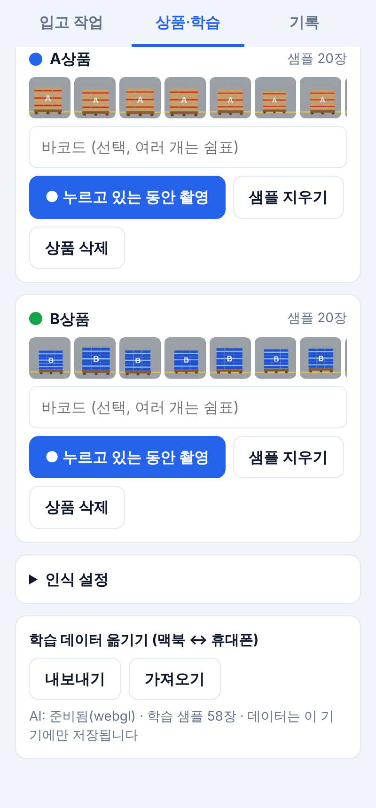
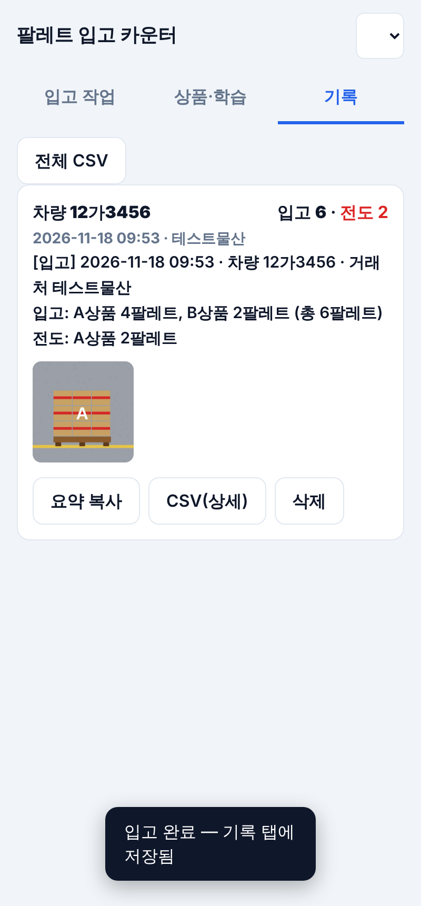

# 팔레트 입고 카운터

맥북 웹캠이나 휴대폰 카메라로 **하차되는 팔레트를 상품별로 인식해서 자동으로 셉니다.**
전도(넘어짐)는 사진과 함께 기록하고, 끝나면 이런 요약이 만들어집니다.

```
[입고] 2026-11-18 09:52 · 차량 12가3456 · 거래처 테스트물산
입고: A상품 4팔레트, B상품 2팔레트 (총 6팔레트)
전도: A상품 2팔레트
```

| 입고 작업 | 상품·학습 | 기록 |
|---|---|---|
|  |  |  |

## 동작 원리 (쉽게)

1. **AI가 사진을 비교합니다.** 상품마다 팔레트 사진을 30장쯤 찍어 두면, 카메라 화면이 어느 상품과 가장 닮았는지 판단합니다.
2. **같은 상품이 0.8초 이상 보이면 +1.** 그 팔레트가 화면에 있는 동안은 다시 세지 않습니다.
3. **빈 화면이 1.2초 이상 보이면** 다음 팔레트를 기다립니다.
4. 바코드/QR 라벨이 있으면 **바코드 모드**가 더 정확합니다.

> AI 모델(MobileNetV2)이 브라우저 안에서 돌아갑니다. **영상·사진은 외부로 전송되지 않고** 이 기기에만 저장됩니다.

## 사용 순서

1. **상품·학습** 탭
   - 상품 추가 (A상품, B상품 …)
   - `빈 화면(배경)`: 팔레트 없는 하차장 바닥을 `누르고 있는 동안 촬영` (30장 이상)
   - 상품별: 팔레트를 여러 각도·거리로 촬영 (30장 이상)
   - 위 카메라 화면에 인식 결과가 바로 나오니 맞는지 확인
2. **입고 작업** 탭 → 차량번호 입력 → `입고 시작`
   - 팔레트가 카메라 앞을 지나가면 자동 카운트 (삐 소리 + 진동)
   - 틀리면 상품 타일의 `+` / `−`, 또는 `되돌리기`
   - 넘어지면 `전도(넘어짐) 기록` → 사진 자동 첨부
3. `입고 완료` → **기록** 탭에서 요약 복사 / CSV(엑셀) 저장

## 실행 방법

카메라는 보안상 **HTTPS 주소**(또는 내 컴퓨터 `localhost`)에서만 켜집니다.

**A. GitHub Pages (휴대폰 사용 시 권장, 무료)**
저장소 Settings → Pages → Branch 선택 → 폴더 `/ (root)` → Save.
1~2분 뒤 나오는 `https://….github.io/inbound/` 주소를 휴대폰으로 열면 됩니다.

**B. 맥북에서 바로 테스트**

```bash
python3 -m http.server 8080
```

브라우저에서 `http://localhost:8080` 접속.

설치할 프로그램은 없습니다. AI 라이브러리·모델이 저장소에 포함돼 있어 **인터넷이 약한 창고에서도** 첫 로딩 후 동작합니다.

## 현장 설치 팁

- 카메라는 **팔레트가 한 개씩 지나가는 지점**(도크 출입구, 지게차 동선)을 고정해서 비추세요.
- 화면의 **점선 사각형**이 AI가 보는 영역입니다. 팔레트가 이 안에 크게 들어오게 하세요.
- 학습할 때와 같은 위치·조명에서 쓰면 정확도가 높습니다. 장소를 바꾸면 `빈 화면`을 다시 촬영하세요.
- 맥북에서 학습 → `내보내기` → 휴대폰에서 `가져오기`로 학습 데이터를 옮길 수 있습니다.

## 한계 (꼭 알아두세요)

| 상황 | 결과 | 대응 |
|---|---|---|
| 같은 상품 팔레트가 빈 화면 없이 연달아 지나감 | 1개로 셀 수 있음 | 팔레트 간 간격 두기, 또는 `+` 보정 |
| 겉모양이 거의 같은 상품 (같은 박스·랩핑) | 구분 어려움 | **바코드 모드** 사용 |
| 조명·카메라 위치가 학습 때와 크게 다름 | 오인식 증가 | 현장에서 다시 촬영 |
| 전도(넘어짐) | 자동 감지 아님 | 버튼으로 기록 + 사진 증빙 |

자동 카운트는 보조 수단입니다. 최종 수량은 `입고 완료` 전 화면에서 확인하세요.

## 설정 (상품·학습 → 인식 설정)

| 항목 | 기본값 | 뜻 |
|---|---|---|
| 인식 확정 시간 | 0.8초 | 이 시간 이상 같은 상품이 보여야 +1 |
| 팔레트 사이 빈 화면 시간 | 1.2초 | 이 시간 이상 비어야 다음 팔레트 |
| 최소 신뢰도 | 70% | 이보다 낮으면 "판단 보류" (안 셈) |
| 같은 바코드 재스캔 무시 | 끔 | 팔레트마다 고유 바코드(SSCC)일 때 켜기 |

## 파일 구조

```
index.html          화면
css/app.css         디자인
js/app.js           화면 동작 연결
js/counter.js       카운트 규칙 (상태 기계) ← 핵심
js/recognizer.js    AI 인식 (MobileNetV2 + KNN)
js/barcode.js       바코드/QR 인식
js/camera.js        카메라
js/report.js        요약 문구·CSV
js/store.js         저장 (localStorage / IndexedDB)
models/             AI 모델 (1.6MB)
vendor/             TensorFlow.js, ZXing
tests/              자동 테스트
```

## 테스트

```bash
npm test
```

```bash
npm run e2e
```

`npm test`: 카운트 규칙·요약 문구 (13개). `npm run e2e`: 가상 카메라로 학습 → 자동 카운트 → 전도 → 바코드 → 기록까지 실제 브라우저에서 검증.

## 라이선스 / 출처

- TensorFlow.js 4.22.0 (Apache-2.0)
- ZXing JS 0.21.3 (Apache-2.0)
- MobileNetV2 0.35 특징추출 가중치 (Google Teachable Machine 배포본, Apache-2.0)
