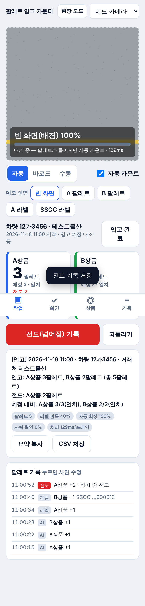
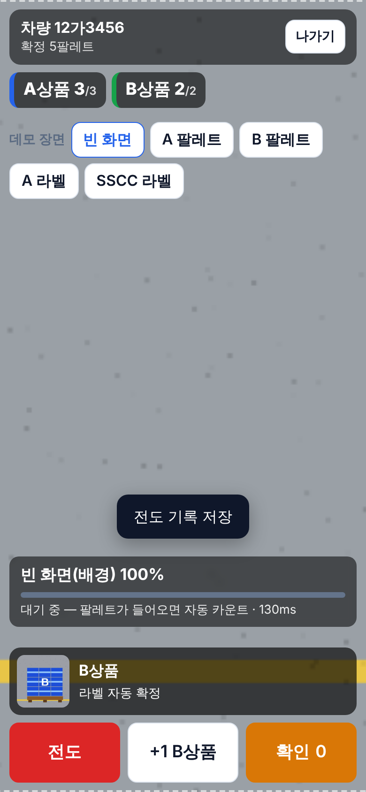
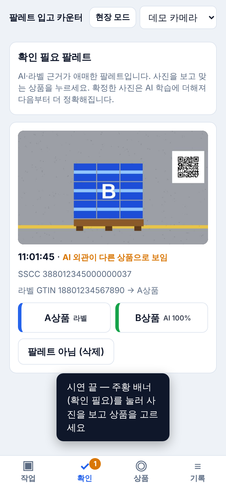

# 팔레트 입고 카운터

휴대폰·맥북 카메라로 **하차되는 팔레트를 상품별로 식별하고 수량을 셉니다.**
전도(넘어짐)는 사진과 함께 기록하고, 끝나면 이런 요약이 나옵니다.

```
[입고] 2026-11-18 10:56 · 차량 12가3456 · 거래처 테스트물산
입고: A상품 3팔레트, B상품 2팔레트 (총 5팔레트)
전도: A상품 2팔레트
예정 대비: A상품 3/3(일치), B상품 2/2(일치)
```

| 입고 작업 | 현장 모드 | 확인 필요 | 상품·학습 |
|---|---|---|---|
|  |  |  |  |

## 화물을 어떻게 식별하나 (조사 결과 반영)

해외 논문·상용 사례 조사([보고서](reports/하역%20팔레트%20화물%20식별%20카운팅.md)) 결론: **확인된 상용 도크 시스템은 모두 라벨로 상품을 판정하고, 외관 AI는 보조로 씁니다.**
이 앱도 같은 순서로 판단합니다.

| 순서 | 근거 | 이 앱의 처리 |
|---|---|---|
| ① | **GS1 팔레트 라벨의 GTIN** (AI 02 / 01) | 상품 마스터와 일치 → 자동 확정 |
| ② | **SSCC + 입고 예정(ASN)** | SSCC만 있는 라벨도 예정 목록으로 상품 확정. 같은 SSCC 재스캔은 세지 않음 |
| ③ | **AI 외관 인식** | 팔레트가 보이는 동안 여러 프레임을 모아 판정. 입고 예정 상품 중에서만 고름 |
| ④ | **사람 확인** | 근거가 애매하거나, 라벨과 외관이 다르거나, 예정에 없는 상품이면 '확인 필요'로 보냄. 사진 보고 한 번 누르면 확정, 그 사진은 AI 학습에 추가 |

팔레트마다 **증빙 사진, SSCC·GTIN·배치·유통기한·박스 수, 식별 방식, 신뢰도**가 기록되고 CSV로 나갑니다.

## 사용 순서

1. **상품** 탭: 상품 추가 → GTIN 입력(라벨 식별용) → `빈 화면`과 상품 팔레트를 각각 30장 이상 촬영(누르고 있는 동안 촬영)
2. **작업** 탭: 차량번호 → (선택) 입고 예정 목록 붙여넣기 → `입고 시작`
   - 엑셀에서 `상품명, 팔레트수, SSCC(선택)` 열을 복사해 붙여넣으면 됩니다.
3. 팔레트가 카메라 앞을 지나가면 자동 카운트. **현장 모드**는 카메라 전체 화면 + 큰 버튼(전도 / +1 / 확인)
4. 주황 배너 **확인 필요**가 뜨면 사진을 보고 상품을 누름
5. `입고 완료` → **기록** 탭에서 요약 복사 / CSV(엑셀)

카메라 없이 보려면 `카메라 없이 1분 체험` 버튼을 누르세요. 가상 하차장으로 학습 → ASN → AI 카운트 → GS1 라벨 → SSCC 대조 → 라벨·외관 불일치(확인 필요)까지 자동으로 보여줍니다.

## 실행 방법

카메라는 보안상 **HTTPS 주소**(또는 내 컴퓨터 `localhost`)에서만 켜집니다.

**A. GitHub Pages (휴대폰 권장, 무료)** — 저장소 Settings → Pages → 브랜치 선택, 폴더 `/ (root)` → Save. 나오는 주소를 휴대폰으로 열고 **홈 화면에 추가**하면 앱처럼 쓰고, 오프라인에서도 열립니다.

**B. 맥북에서 바로**

```bash
python3 -m http.server 8080
```

브라우저에서 `http://localhost:8080` 접속. 설치할 것은 없습니다(AI 모델·라이브러리 포함, 서버 불필요).

## 현장 설치 팁

- **라벨은 팔 길이 거리에서 비추세요.** 풀HD 화면으로 바코드를 읽을 수 있는 폭은 약 0.3~0.5m입니다(조사 보고서 계산). 팔레트 전체를 한 화면에 담으면 라벨은 거의 안 읽힙니다.
- 고정 카메라는 팔레트가 **한 개씩 지나가는 지점**을 비추고, 점선 사각형(AI 영역) 안에 팔레트가 크게 들어오게 하세요.
- 도크 문 역광·햇빛은 라벨 판독을 망칩니다. 어두운 트럭 안은 **손전등** 버튼(안드로이드 크롬)을 쓰세요.
- 맥북에서 학습 → `내보내기` → 휴대폰에서 `가져오기`로 학습 데이터를 옮길 수 있습니다.

## 검증 지표 (도입 판단용)

조사 결과 도크 팔레트 계수 정확도를 독립 검증한 공개 자료가 없습니다. 그래서 앱이 입고 건마다 직접 잽니다.

| 지표 | 뜻 |
|---|---|
| 라벨 판독률 | 라벨(SSCC/GTIN)이 읽힌 팔레트 비율 — 공급사 라벨 품질 |
| 자동 확정률 | 사람 손 없이 확정된 비율 |
| 사람 확인 비율 | 확인 필요·수동 정정 비율 — 실제 인력 절감을 좌우 |
| 처리 ms/프레임 | 그 기기의 AI 처리 속도 (휴대폰 브라우저 실측 공개 자료가 없어 직접 측정) |

## 한계

| 상황 | 결과 | 대응 |
|---|---|---|
| 라벨 없는 팔레트 + 같은 박스에 다른 상품 | 외관으로는 원리적으로 구분 불가 | 공급사에 GS1 라벨(AI 02+37)·ASN 요구, 또는 사람 확인 |
| 같은 상품이 빈 화면 없이 연달아 통과 | 1개로 셀 수 있음 | 팔레트 간 간격, `+` 보정, 팔레트 상세에서 수량 2 |
| 2단 적재 | 1개로 셈 | 팔레트 상세에서 수량 수정 |
| 조명·위치가 학습 때와 다름 | 오인식 증가 → 확인 필요 증가 | 현장에서 다시 촬영, 확인 결과가 자동으로 학습에 추가됨 |
| 전도(넘어짐) | 자동 감지 아님(공개 연구·데이터 없음) | 버튼 기록 + 사진 증빙 |
| 전용 팔레트 탐지 모델 | 미포함 | 도크 공개 데이터셋 부재, YOLO 계열 AGPL 라이선스 문제. 현장 영상이 모이면 다음 단계에서 검토 |

자동 카운트는 검수 보조입니다. 최종 수량은 `입고 완료` 전에 사람이 확인하세요.

## 파일 구조

```
index.html  css/app.css      화면 (휴대폰 우선, 하단 탭, 현장 모드)
js/app.js                    화면 동작 연결
js/counter.js                팔레트 카운트 규칙 (상태 기계)
js/identify.js               팔레트별 근거 모아 상품 판정 (확정 / 확인 필요)
js/gs1.js                    GS1 라벨 파서 (SSCC·GTIN·배치·유통기한·수량)
js/expected.js               입고 예정(ASN) 붙여넣기·예정 대비
js/recognizer.js             AI 외관 인식 (MobileNetV2 + KNN)
js/barcode.js                바코드/QR (내장 BarcodeDetector, 없으면 ZXing)
js/camera.js  js/democam.js  영상 입력 (카메라 / 데모 / 동영상 파일)
js/report.js  js/store.js    요약·CSV·검증 지표 / 기기 내 저장
sw.js  manifest.webmanifest  홈 화면 설치·오프라인
models/  vendor/  icons/     AI 모델(1.6MB)·라이브러리·아이콘
tests/                       자동 테스트
reports/  research_notes/    해외 논문·사례 조사 보고서와 노트
```

## 테스트

```bash
npm test
```

```bash
npm run e2e
```

`npm test`: 카운트 규칙·GS1 파서·식별 판정·입고 예정·보고서(37개). `npm run e2e`: 휴대폰 화면 크기 실제 브라우저에서 학습 → ASN → AI 카운트 → GS1 라벨 → SSCC 대조·중복 방지 → 전도 → 현장 모드 → 기록, 그리고 카메라 없는 환경의 자동 시연 → 확인 필요 → 사람 확정까지 검증.

## 라이선스 / 출처

- TensorFlow.js 4.22.0 (Apache-2.0)
- ZXing JS 0.21.3 (Apache-2.0)
- MobileNetV2 0.35 특징추출 가중치 (Google Teachable Machine 배포본, Apache-2.0)
